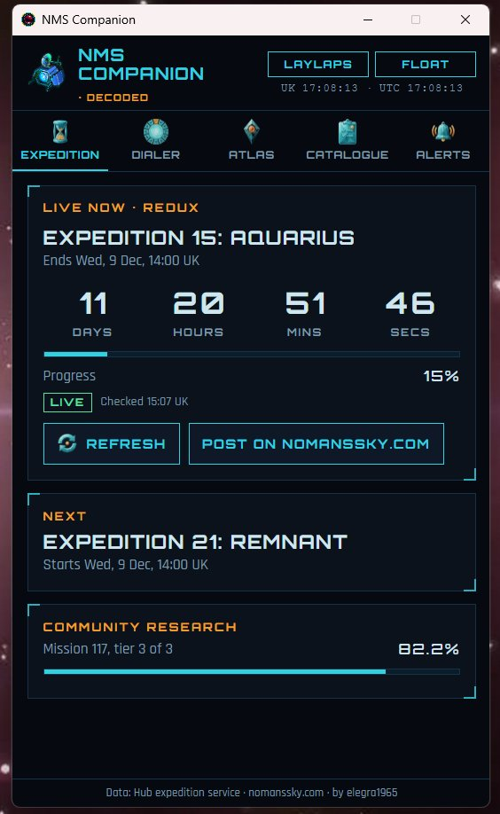
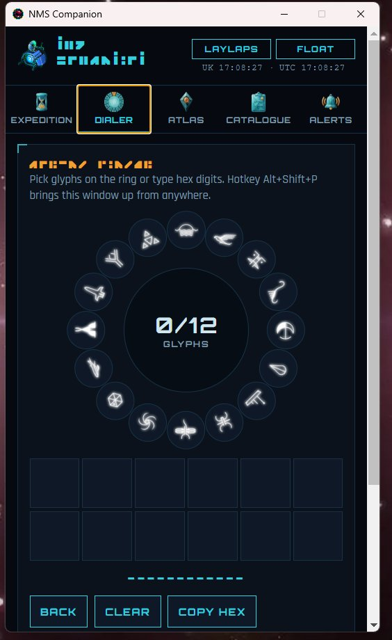
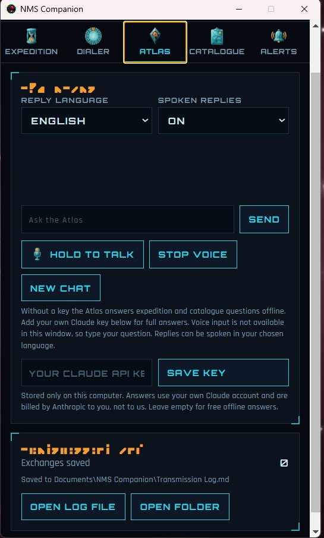
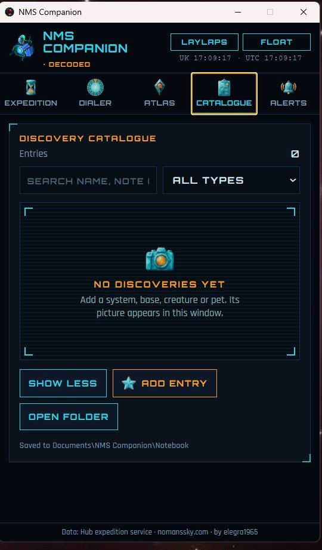
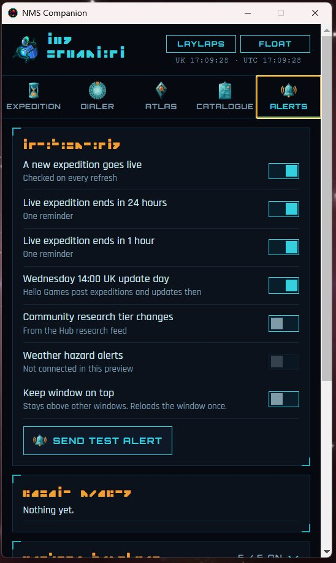
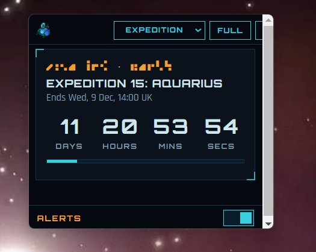
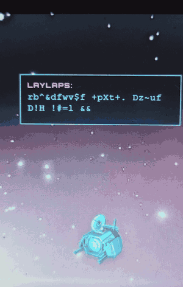

# NMS Companion

Free desktop companion for No Man's Sky. No account, no ads.

- Expedition countdown with live data from nomansskyhub.app
- Portal Dialer (glyphs + hex) with Alt+Shift+P hotkey
- Atlas desk: offline answers, or your own Claude key (optional)
- Discovery catalogue for systems, bases, creatures and pets
- Laylaps mode plays a quiet hover hum with an occasional beep, recorded from the game (Hello Games' sound). Switch it off any time: click Laylaps, untick Laylaps sounds.
- Alerts: new expedition, 24 h and 1 h reminders, Wednesday update day
- Laylaps, a floating sentinel that pops up alerts

Everything is saved on your own computer (Documents/NMS Companion). Use Export/Import backup in the Alerts tab to move to a new computer.

## Screenshots
| Expedition | Portal Dialer | Atlas desk |
|---|---|---|
|  |  |  |

| Catalogue | Alerts | Float window |
|---|---|---|
|  |  |  |

Laylaps, the floating sentinel: 

Laylaps in action (filmed on a real desktop):

| Bobbing on the desktop | Alert decoding from the alien font |
|---|---|
|  |  |

## Download
See the Releases page. The app is not code-signed, so Windows may show "unknown publisher" (More info, Run anyway) and macOS may need right-click, Open.

Built by elegra1965. No Man's Sky, its names, pictures and sounds belong to Hello Games. This is an unofficial fan project, not affiliated with or endorsed by Hello Games. The Atlas and Laylaps artwork is used as fan art with credit to Hello Games. Data: Voyager's Haven, NMS Almanac, nomanssky.com posts.

## Privacy
The app sends nothing about you anywhere. It only contacts: map.nomansskyhub.app (expedition schedule, read only), nomanssky.com (official news), api.github.com (checks for a newer version and downloads updates), and, only if you add your own key, api.anthropic.com (your Atlas questions). If you turn on Laylaps weather alerts and type a city, that place (city, postcode or country) is sent to nominatim.openstreetmap.org (to find it) and open-meteo.com (the forecast) and nowhere else. Your name, city and reminders are stored only on your computer. No accounts, no analytics, no tracking. Your catalogue, settings and key stay on your computer.

## Laylaps
The floating sentinel chats while you wait (expedition news, update day, NMS lore, tips), uses the name you give him, falls asleep when you are away (and wakes with a dream), raises weather alerts for your city and keeps reminders. Set up under Alerts, Laylaps, or click him and choose Laylaps setup. A what's-new card shows once after each update.

## Code signing policy
Free code signing provided by [SignPath.io](https://signpath.io), certificate by [SignPath Foundation](https://signpath.org) (application pending; releases are unsigned until approved).
- Licence: MIT. All code in this repository is open source.
- Windows installers are built only by the GitHub Actions workflow in this repository, from the public source.
- Maintainer, author and approver: elegra1965 (two-step login on GitHub and SignPath). Every signing request is approved by hand.
- Privacy: see the Privacy section above.

## Build
`npm install` then `npm start`. A new release is built by every push to main (GitHub Actions).

Updates: on Windows the app updates itself from the Alerts tab (THIS APP, Download update). The app is not code-signed yet, so Windows Smart App Control (a Windows 11 setting) blocks the installer and the update silently does nothing. If that happens the app says so on the next start. Smart App Control cannot allow single apps; it has to be turned off in Windows Security, App and browser control, or the app can be installed after SignPath signing is approved. The normal SmartScreen warning is fine: choose More info, Run anyway.
